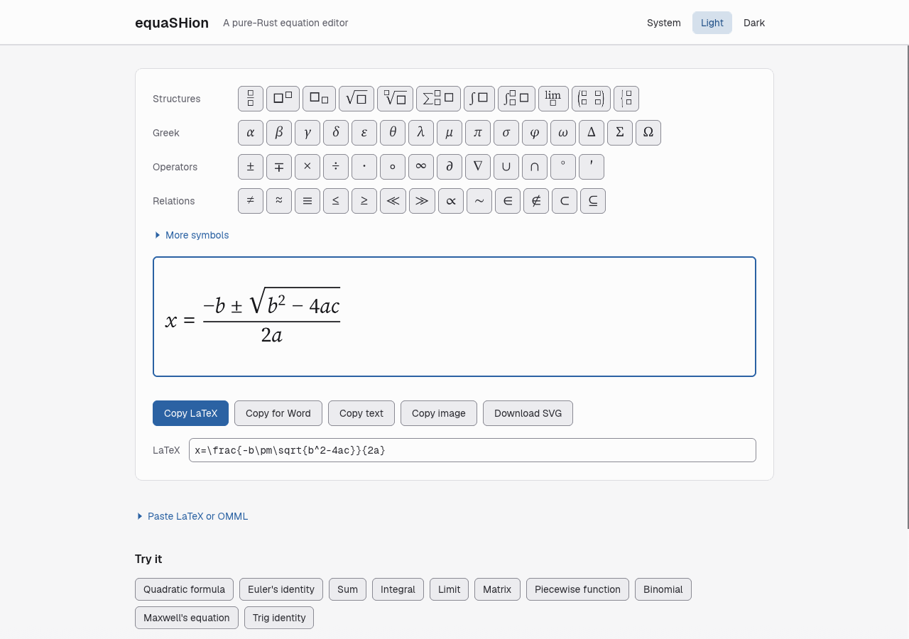
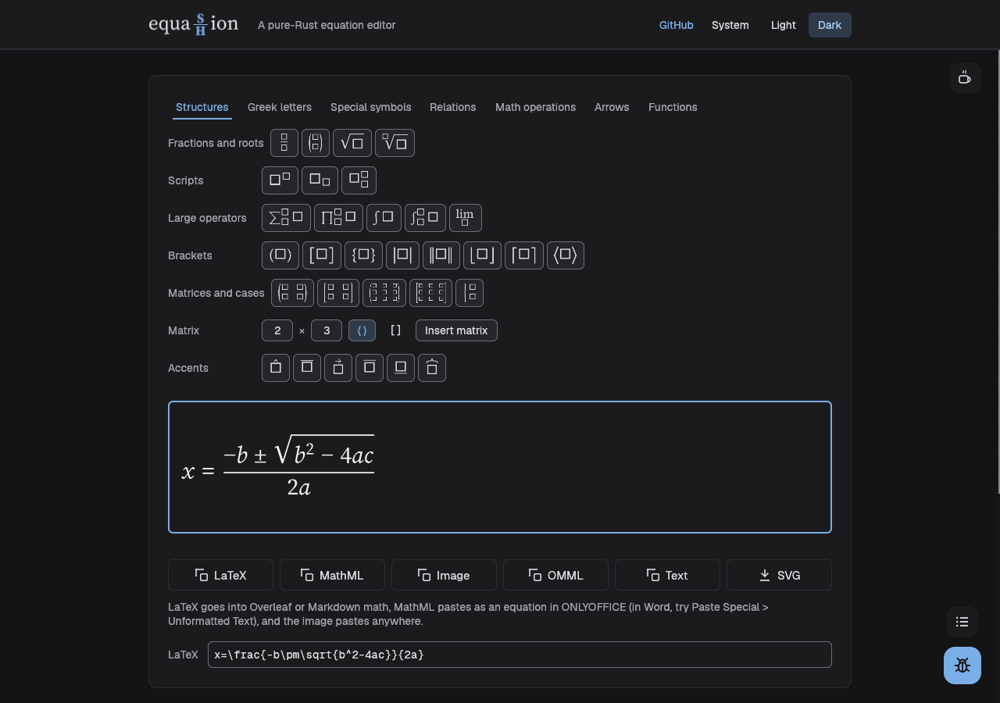

# equaSHion

A pure-Rust equation editor.

Typing behaviour is modelled on MathLive (cortexjs.io/mathlive). equaSHion is an independent Rust
implementation, not a port and not affiliated with MathLive; no MathLive code is used.

An equation editor engine in Rust: a math tree with OMML (Word/PowerPoint) import and export
and a typed linear/LaTeX-like input format, an editing model (caret, selection, templates,
undo), TeX-style layout into a backend-neutral scene with caret geometry, and renderers for
that scene (RGBA pixels and SVG).

It is the equation editor extracted from WordCraft at `dbfe1b1`, with three edit-model tests
from DeckCraft at `7972cf5`. See [PROVENANCE.md](PROVENANCE.md) for what was taken and changed,
and [DIVERGENCE.md](DIVERGENCE.md) for behaviour that now differs from WordCraft.

## Crates

| Crate | Path | Depends on | What it does |
|---|---|---|---|
| `equashion-math` | `crates/math` | quick-xml, serde | Math tree, OMML import/export, presentation MathML import/export (`to_mathml`, `from_mathml`), linear format, templates, edit model (`Editor`, `Caret`, `Key`) |
| `equashion-font` | `crates/font` | skrifa, harfrust, kurbo | Font database (`FontDb`, `FontDb::bundled_only()`), outlines, fallback, shaping; bundles Source Serif 4 (default family), Inter and STIX Two Math (symbol fallback) |
| `equashion-layout` | `crates/layout` | math, font, kurbo | `layout_equation` -> `EqLayout` (a `Scene` plus caret rectangles and hit testing), `layout_math_wrapped`, `LayoutCache`, the `MathFonts` trait |
| `equashion-render` | `crates/render` | layout, vello_cpu | `render_scene` / `render_eq` to premultiplied RGBA, `scene_to_svg` |
| `equashion-egui` | `crates/egui` | math, layout, render, egui | `EquationEditor`: the equation editor as an egui widget (palette, canvas with caret, linear field), no host types |
| `equashion-web` | `apps/equashion-web` | egui widget, render, eframe (wasm, glow) | The web page: the editor with a symbol palette, Copy as LaTeX / MathML / image (and OMML / text / SVG behind More), paste-in, examples, light and dark themes, `window.equashion` test hooks |
| `xtask` | `xtask` | std | `cargo xtask check`, `bless`, `web`, `serve`, `smoke` |

```rust
use equashion_layout::{DEFAULT_FAMILY, FontDb, Rgb, layout_equation};

let fonts = FontDb::bundled_only();
let m = equashion_math::from_linear(r"x=\frac{-b\pm\sqrt{b^2-4ac}}{2a}");
let eq = layout_equation(&fonts, &m, DEFAULT_FAMILY, 24.0, true, Rgb::BLACK, 4.0);
let svg = equashion_render::scene_to_svg(&eq.scene, &fonts, DEFAULT_FAMILY);
let pixels = equashion_render::render_eq(&eq, &fonts, 2.0);
```

`equashion-layout`, `equashion-render` and `equashion-egui` build for `wasm32-unknown-unknown`.

## The egui widget

```rust
use equashion_egui::EquationEditor;

let mut editor = EquationEditor::with_linear(r"\frac{a}{b}"); // or ::new(), ::with_omml(xml)
// every frame:
let r = editor.show(ui);
if r.changed   { /* editor.linear(), editor.omml(), editor.math() */ }
if r.committed { /* Enter: keep editor.omml() */ }
if r.cancelled { editor.revert(); /* Esc (confirmed when there were changes) */ }
```

| Item | What it is |
|---|---|
| `EquationEditor::new()`, `with_linear(&str)`, `with_omml(&str)` | Construct (OMML import never fails, so `with_omml` returns `Self`) |
| `.id_salt(h)`, `.fonts(Arc<FontDb>)`, `.family(&str)`, `.font_size(pt)`, `.canvas_height(pt)`, `.show_palette(bool)`, `.show_linear_field(bool)`, `.auto_focus(bool)`, `.caret_blink(bool)` | Builder options (`set_caret_blink` on an existing editor, for reduced motion) |
| `show(&mut self, &mut Ui) -> EditorResponse` | Draw palette, canvas, linear field and message line |
| `EditorResponse { changed, committed, cancelled, response, rect }` | `response` is the canvas, `rect` the whole widget |
| `linear()`, `omml()`, `math()`, `unknown_commands()` | Read the equation |
| `set_linear(&str)`, `set_omml(&str)`, `set_math(Math)` | Load (resets the Esc baseline) |
| `revert()`, `is_dirty()`, `mark_clean()`, `message()` | Esc baseline and the status line |
| `editor()`, `editor_mut()` + `sync_linear()` | The underlying `equashion_math::Editor` |
| `canvas_id()`, `linear_id()`, `id()` | egui ids (all derived from the widget id) |

Keys: typing builds the tree (`x^2`, `a/b`, `sqrt`, `alpha`, `\frac{..}{..}`), arrows / Home /
End / Backspace / Delete edit it, Tab and Shift+Tab move between places, Ctrl+Z, Ctrl+Shift+Z
and Ctrl+Y undo and redo, Ctrl+A selects all, Ctrl+C / Ctrl+X copy and cut the selection as
linear text, Enter commits, Esc cancels (the first Esc with changes only asks). A click places
the caret, a drag or Shift+click selects, also across rows.

Shared-context rules the widget keeps (pinned by `crates/egui/tests/shared_context.rs`): it never
calls `set_fonts`, `set_visuals` or `set_style`; it uses only `FontId::proportional` /
`FontId::monospace`; equation and palette glyphs are rasterised by `equashion-render` and drawn
as textures tinted with `ui.visuals()` colours (works in light and dark; the canvas also takes the
host's control corner radius); texture names start
with `equashion/`; it reads keys only while its canvas has focus and never takes focus from
another widget.

```sh
cargo run -p equashion-egui --example widget            # native window, dark
cargo run -p equashion-egui --example widget -- --light # light theme
```

The example shows the widget with live linear and OMML readouts.

## The web page

One eframe app compiled to wasm (WebGL2 through glow, no wgpu, no JavaScript framework). It is a
tool: type an equation, copy it out.




One centred column, top to bottom:

- **Header**: the wordmark, the tagline and a System / Light / Dark theme toggle (System follows
  `prefers-color-scheme`).
- **Editor**: a symbol palette in tabs by context (Structures, Greek letters, Special symbols,
  Relations, Math operations, Arrows, Functions, ordered like Google Docs' equation toolbar), each tab split into labelled groups, then the `EquationEditor`
canvas. Every palette face is rendered by equashion-render, not by egui's fonts. A long
  equation shrinks to half size and then scrolls sideways to keep the caret in view.
- **Copy button** under the canvas: one full-width button with its format drop-down built in.
  The drop-down lists Copy LaTeX, Copy MathML (for ONLYOFFICE, LibreOffice Math and Word), Copy
  image, Copy OMML (Word equation XML), Copy text and Download SVG; picking one makes it the
  button's format. One line under it says where each format pastes. Then the current LaTeX in a read-only line you can
  select.
- **Paste LaTeX, MathML or OMML** (a disclosure): a field and a Load button that replaces the equation.
- **Try it**: ten examples from `corpus/equations.tsv`, and **How to type**, a short cheat sheet
  (each line is checked against the editor in `apps/equashion-web/tests/showcase.rs`).
- **Footer**: the MathLive credit and **About and licences**, which opens a panel with what it
  is, credits, the licence and known limits.
- **Report a Bug button**, bottom right like raSHio's: the accent button opens the "Report an
  issue" panel, the small one above it opens the list of what was reported. In the panel pick Bug
  (doesn't work), Quirk (works, but picky) or Improve (wish it had), add a title (100 characters)
  and a description (2000), and optionally attach a screenshot (a file or a pasted image, 1 MB at
  most). No sign-in. The report carries the equation in the editor, the browser and the page
  address. In the list each issue shows its status and has a Vote button. Reports become GitHub
  issues; see [docs/issue-reports.md](docs/issue-reports.md).
- **Buy me a coffee**: a mug button top right, just under the header, ported from inishial. It
  opens Buy Me a Coffee's hosted panel (`data-id="shuff57"`) hanging down from the button, and a
  one-line invitation shows once per session for ten seconds. This is the only third-party
  request the page makes (`cdnjs.buymeacoffee.com`, loaded from `index.html`); with the network
  off the button does nothing. `apps/equashion-web/coffee.js` holds the behaviour. To use
  another handle, change `data-id` in `index.html`.

### What each Copy button puts on the clipboard

| Button | MIME types | Content |
|---|---|---|
| Copy LaTeX | `text/plain` | `to_latex` (`x=\frac{-b\pm\sqrt{b^2-4ac}}{2a}`) |
| Copy MathML | `text/plain`, `text/html` | plain: `to_mathml_display(m, true)`, which starts exactly with `<math xmlns="http://www.w3.org/1998/Math/MathML" display="block">` (no XML declaration, no DOCTYPE, no prefix, no named entities). HTML: `<html><body><!--StartFragment-->` + the same `<math>` element + `<!--EndFragment--></body></html>`, nothing else (no image) |
| Copy image | `image/png` | black ink on white at 2 pixels per point, 20 pt equation size, tagged 144 dpi |
| Copy OMML (More) | `text/plain` | `to_omml`: `m:oMathPara` / `m:oMath` with `xmlns:m` declared. For programs and code that read OMML |
| Copy text (More) | `text/plain` | `to_linear` (`x=(−b±√(b^2−4ac))/2a`); pastes back into this page |
| Download SVG (More) | (a file, `image/svg+xml`) | `equation.svg` from equashion-render's SVG backend, black ink, glyphs as paths |

The `copy(kind)` hook takes `mathml`; `word` (the old "Copy for Word") is an alias of it.

#### Where it pastes: what was verified

Tested on Fedora 44 (KDE, Wayland) on 2026-10-10. The real-paste tests ran in a private Xvfb
display with their own ONLYOFFICE and LibreOffice instances, a PySide6 clipboard owner offering
`text/plain` + `text/html` exactly as the page writes them, and `xdotool` for Ctrl+V; the
results were saved and the saved files inspected.

- **ONLYOFFICE Desktop Editors 9.4.0** (flatpak), document editor: pasting Copy MathML gives an
  equation. ONLYOFFICE reads the `text/html` copy: with `text/html` alone the saved `.docx` has
  `<m:oMathPara><m:oMath>` with `m:f`, `m:rad`, `m:sSup`; with `text/plain` alone the MathML
  arrives as literal text. All 44 rows of `corpus/equations.tsv` were pasted one by one, saved,
  and read back with `from_omml`: every row came back as an equation with its structure
  (fractions, roots, scripts, n-ary operators with limits, matrices and cases in delimiters,
  limits, accents, braces, boxes). ONLYOFFICE turns letters into math italic (`𝑥`) and writes
  integrals with limits above and below.
  - ONLYOFFICE bug: `<`, `>` and `&` inside the equation show as the text `&lt;`, `&gt;`,
    `&amp;`, whether written as numeric references, named entities or CDATA.
  - ONLYOFFICE reads an `munder`/`mover` that is not an accent or a brace as a limit and
    swallows the element after it. The writer therefore puts U+2061 (function application, as
    Word writes `lim`) after limits and over/under arrows, and writes accents with the
    combining mark (U+0302 and so on), which ONLYOFFICE maps to `m:acc`.
- **LibreOffice 26.2.6.3**: Writer does **not** convert pasted MathML. A real Ctrl+V of the page's
  clipboard gave the flat text `x=−b±b2−4ac2a` (Writer takes the HTML and drops the markup); the
  same happens when an `.html` file with the `<math>` fragment is converted headlessly. In
  **LibreOffice Math**, Tools > Import MathML from Clipboard with the same clipboard gives the
  formula `x = frac{-b +- sqrt{b^2-4ac}}{2a}`. A `.mml` file of the MathML opens as a formula
  (`soffice --headless --convert-to odf`, the StarMath annotation shows the structure: sums,
  integrals, matrices, roots, limits, fractions, cases). LibreOffice drops accents (hat, vec,
  bar...) on MathML import, even from MathML it exported itself.
- **OMML in a document**: a `.docx` whose `w:p` holds `to_omml` output for three equations opens
  as three formula objects in LibreOffice (`--convert-to odt`) and in ONLYOFFICE's converter
  (`x2t omml.docx omml.odt`).
- **Image**: the PNG bytes are checked (magic, size) in the smoke test; pasting them anywhere
  was not tested beyond that.

#### Not verified

- **Microsoft Word** (no Office install here). Word is documented to turn pasted *text* that
  starts with a MathML header into an equation, sometimes only through Paste Special >
  Unformatted Text, which is why Copy MathML also writes the MathML as `text/plain` and the
  page's one-line guide names that route. Whether Word prefers the `text/html` copy on a normal
  Ctrl+V is not known.
- PowerPoint, Google Docs, Pages, Outlook, WordCraft and DeckCraft.
- LaTeX targets (Overleaf, Markdown, Anki): the LaTeX is the same text as before and was not
  re-tested in those programs.

How the browser writes it (`apps/equashion-web/index.html`): text kinds go through a `copy`
event started with `document.execCommand('copy')` inside the click, which writes every type
exactly as given; if that is refused, `navigator.clipboard.writeText` or `navigator.clipboard.write`
with a `ClipboardItem`. The image always uses `navigator.clipboard.write` with an `image/png`
`ClipboardItem`. Known browser limits:

- The Clipboard API only exists on HTTPS pages and `localhost` / `127.0.0.1`. Served over plain
  HTTP elsewhere, every Copy falls back.
- `navigator.clipboard.write` with `text/html` may be sanitised by Chromium; that is why text goes
  through the `copy` event first, which writes the HTML exactly as given.
- Image copy needs `ClipboardItem` with `image/png`: Chromium and Edge, Firefox 127 and later,
  Safari 13.1 and later. Safari may refuse it here because the write starts in the next
  animation frame rather than directly in the click handler.
- When the browser refuses, the page shows the text selected in a field to copy with Ctrl+C
  (Cmd+C on a Mac); for the image it offers a PNG download instead.

### Paste in

Ctrl+V (Cmd+V) in the canvas reads the clipboard text as MathML when it starts with `<` and has a
`<math>` element (with or without a prefix such as `mml:`, also inside an HTML fragment), as OMML
when it starts with `<` and has an `<m:oMath` or `<oMath` element, as LaTeX when it has a backslash or a `$` wrapper (`$..$`,
`$$..$$`, `\(..\)` and `\[..\]` are dropped), and as linear text otherwise, and inserts it at
the caret (replacing a selection). The Paste LaTeX, MathML or OMML field reads the same way but
replaces the whole equation. Unknown backslash commands are named in one sentence under the canvas.
Text over 20000 characters, empty text and OMML or MathML with no content are refused with a sentence;
the parsers have depth and size limits, so hostile input does not panic (unit-tested). Copying
an equation out of Word puts its linear or LaTeX form, not OMML, in the plain-text clipboard,
so a paste from Word arrives as text.

### Building and testing

`prefers-reduced-motion` turns egui's hover animations and the caret blink off.

Design tokens (`apps/equashion-web/src/theme.rs`, where every value is listed): one accent,
`#2b62a3` light / `#7aaee6` dark (the same blue, saturation under 80%), on a zinc neutral ramp
(page `#f6f6f7` / `#141416`, text `#2a2a30` / `#dcdce1`); every text colour meets WCAG AA in
both themes (unit-tested). Radii: 6 px for controls, 10 px for panels. Spacing: 4, 8, 12, 16,
24, 32. Type: Geist (UI) and Geist Mono (code), loaded with `FontDefinitions` by the web app
only; equations stay in Source Serif 4 with STIX Two Math.

```sh
cargo xtask web     # trunk build --release in apps/equashion-web -> dist/ (prints wasm size)
cargo xtask serve   # http://127.0.0.1:8780/  (EQUASHION_PORT overrides)
cargo xtask smoke   # serve dist/ and run tests/browser/smoke.sh (playwright-cli, headless)
```

Needs `trunk` (0.21) and the `wasm32-unknown-unknown` target; `wasm-bindgen` is pinned to
`=0.2.128` to match the installed `wasm-bindgen` CLI. The canvas is opaque to the DOM, so the
page exposes test hooks on `window.equashion` (the full table is at the top of
`apps/equashion-web/src/web.rs`): `linear()`, `omml()`, `latex()`, `setLinear(s)`,
`setLatex(s)`, `paste(s)`, `copy(kind)` (`latex`, `mathml`, `image`, `omml`, `text`, `svg`;
`word` is an alias of `mathml`; a Promise of `{kind, status, items}` with each MIME type's data),
`copyStatus()`, `copyButtonRect(kind)` (`null` for a button behind More while it is closed),
`showMoreCopy(on)`,
`examples()`, `loadExample(idOrName)`, `selftest()`, `galleryCount()`, `activeTab()` (always
`editor`), `setTab(name)` (accepted and ignored), `showAbout(on)`,
`setDisclosures(more, paste, howto)`, `unknownCommands()`, `theme()`, `themePreference()`,
`setTheme(name)` and `ready`.

The smoke test uses its own playwright-cli session (`equashion`). It checks the hooks and every
Copy payload (MathML that starts with the exact header, parses with the browser's XML parser with
the MathML namespace on the root and has no named entities, the same `<math>` in the HTML
fragment; OMML with `m:f` for a fraction; PNG magic bytes; an `<svg` document), clicks Copy LaTeX,
Copy MathML and Copy OMML (picked from the drop-down) for real and records what the page hands the clipboard,
dispatches real paste events with MathML, OMML, LaTeX and linear text, pastes the output of
`copy('mathml')` back in, loads every example, and saves screenshots
in both themes at 1280 and 700 px wide (closed, and with every disclosure and About open) to
`tests/browser/out/` (gitignored), failing if one is blank or has the wrong theme's brightness
(`tests/browser/check_png.py`). The page is plain egui and is also tested natively with
egui_kittest (`apps/equashion-web/tests/showcase.rs`). The corpus selftest still runs through
the `selftest()` hook, though it is no longer on the page.

## Checks

```sh
cargo xtask check   # fmt --check, clippy -D warnings, all tests, wasm32 check of layout, render, egui, web
cargo xtask bless   # rewrite tests/golden/ after an intended layout change (review the diff)
```

The golden tests lay out every item of `corpus/equations.tsv` and `corpus/omml/*.xml` in Source
Serif 4 at 24 pt with the bundled fonts only, and compare the SVG and a metrics snapshot
(`tests/golden/<id>.svg`, `tests/golden/<id>.json`). Property tests over the same corpus check
the OMML and linear round trips and that every caret position has a finite rectangle inside
the canvas.

## Not built yet

- JPEG export. (The web page encodes PNG with the `png` crate; the library crates still return
  raw RGBA.)

## Licence

MIT OR Apache-2.0, as WordCraft. See [LICENSE-MIT](LICENSE-MIT), [LICENSE-APACHE](LICENSE-APACHE)
and [NOTICE](NOTICE). The bundled fonts (Source Serif 4, Inter, STIX Two Math, and Geist and
Geist Mono for the web page's interface) are under the SIL Open Font License 1.1
([ATTRIBUTION.md](ATTRIBUTION.md)).

## Credits

- Interaction model: MathLive (cortexjs.io/mathlive). Typing behaviour is modelled on MathLive.
  equaSHion is an independent Rust implementation, not a port and not affiliated with MathLive;
  no MathLive code is used.
- Engine code: the equation editor of WordCraft (github.com/storytold/wordcraft) and three
  edit-model tests from DeckCraft (github.com/storytold/deckcraft), taken from the shuff57 forks;
  see [PROVENANCE.md](PROVENANCE.md).
